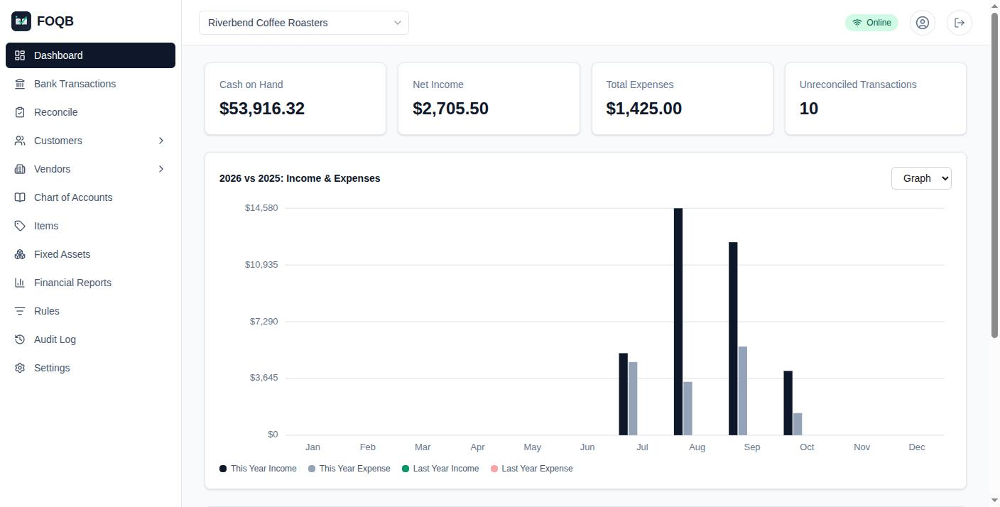
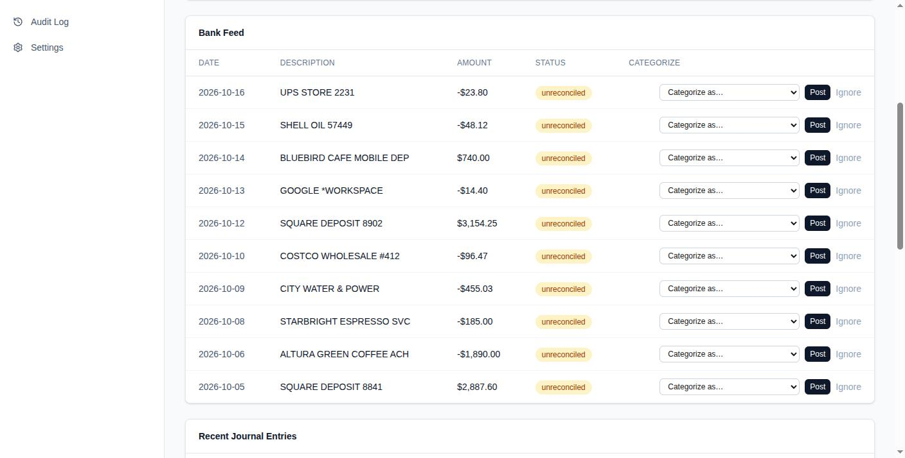
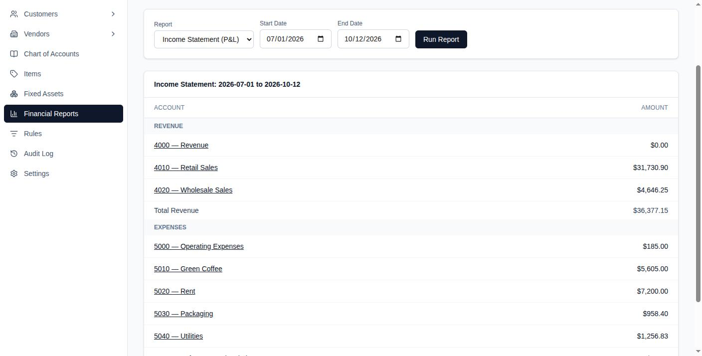
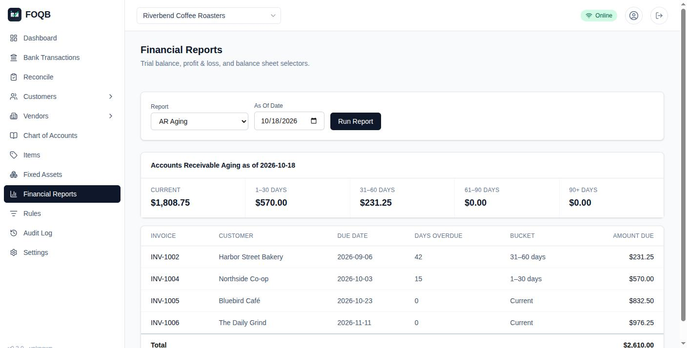

# FOQB — Free, Open, Quality Bookkeeping

A multi-tenant, double-entry accounting PWA built on Next.js and Supabase. Free
to run yourself, open source (AGPL-3.0), no per-seat pricing.

Try it at <https://foqb.parkfour.com>, a public demo that's erased every 6
hours.



| Bank feed | Profit and loss |
|---|---|
|  |  |
| **Receivables aging** | |
|  | |

## How it compares

Feature comparison against Wave's free Starter plan and QuickBooks Online's
cheapest true double-entry plan (Simple Start, $38/mo — QBO's $20/mo
Solopreneur tier is single-entry with no balance sheet, so it isn't a fair
comparison for a general-ledger product like this).

| Feature | **FOQB** | Wave (free) | QBO Simple Start ($38/mo) |
|---|---|---|---|
| Double-entry accounting | ✅ | ✅ | ✅ |
| Chart of accounts / journal entries | ✅ | ✅ (basic) | ✅ |
| Bank connection (live feed) | ✅ (Plaid¹ or SimpleFIN) | ❌ — moved to paid Pro ($19/mo) | ✅ |
| Bank reconciliation | ✅ | not detailed/limited | ✅ |
| Auto-categorization rules | ✅ | ❌ (Pro only) | ✅ |
| Invoicing | ✅ (multi-line; several named sales tax rates, each with its own liability account, and a Sales Tax report) | ✅ | ✅ |
| Estimates, credit memos, customer statements | ✅ | ✅ estimates | ✅ |
| Emailing invoices to customers | ✅ (plugin, through your own mail server) | ✅ | ✅ |
| Recurring invoices/bills | ✅ (generated automatically) | ❌ | ❌ (Essentials+) |
| Bill entry / accounts payable | ✅ (full AP workflow) | ❌ | ✅ |
| Partial payments (AR/AP) | ✅ | not detailed | ✅ |
| Reports: P&L, Balance Sheet, Trial Balance | ✅ all three, plus Cash Flows, General Ledger and P&L by Class | "basic reporting" only | ✅ all three, plus General Ledger |
| AR/AP aging reports | ✅ | ❌ | unclear/likely Essentials |
| Fixed assets + depreciation | ✅ | ❌ | ❌ (Advanced tier only) |
| Inventory tracking | ✅ (average cost, to cost of goods sold) | ❌ | ❌ (Plus/Advanced only) |
| Classes (departments, locations) | ✅ | ❌ | ❌ (Plus only) |
| Audit log | ✅ | ❌ | not advertised at this tier |
| Multi-user / roles | ✅ (owner/accountant/viewer) | ❌ single user (Pro adds users) | ❌ 1 user |
| File attachments (receipts) | ✅ (PDFs and photos, on any entry, bill or bank booking) | ❌ (Pro only) | ✅ |
| CSV import/export | ✅ | limited | ✅ |
| Offline support (PWA) | ✅ | ❌ | ❌ |
| Multi-currency | ✅ (a currency per book, and accounts in other currencies with revaluation) | ❌ | ❌ (Essentials+) |
| 1099-NEC report (contractor vendors, by payment date, card payments left out) | ✅ | ❌ | ✅ |
| Mileage / time tracking | ✅ (IRS rate by trip date; unbilled hours to an invoice) | ❌ | ✅ |
| Payroll | ⚠️ US plugin, to check with a tax professional; files nothing | ❌ (paid add-on) | ❌ (paid add-on) |
| Online payment collection | ✅ (Stripe plugin, Stripe's fees) | ✅ (2.9%+$0.60/txn) | ✅ |
| Self-hosted / open source | ✅ | ❌ | ❌ |
| Cost | $0 (your infra), plus a live feed's fees¹ | $0 | $38/mo |

¹ **For a live bank feed on your own server**, either connect through
[SimpleFIN](https://www.simplefin.org) (about $15 a year per person, paid
to SimpleFIN, nothing to apply for), or get your own Plaid account,
approved for production use, which charges per connected bank. Plaid
approves businesses, not hobbyists. Without either, the statement import
plugin and CSV import still bring in transactions
([docs/BANK_FEED.md](docs/BANK_FEED.md)).

Receipts and documents attach to any journal entry, so to every bill,
expense and bank booking; the receipt-scanning plugin keeps the photo it
read with the bill. Each book has
its currency (KRW or JPY, say), and a bank account, card or loan inside it
can be kept in another, with revaluation to an exchange gain or loss
([docs/CURRENCY.md](docs/CURRENCY.md)).

### Open-source alternatives

If you'd rather run open-source software, these are the usual choices.
"?" marks something we couldn't confirm.

| | **FOQB** | Akaunting | Bigcapital | ERPNext | LedgerSMB |
|---|---|---|---|---|---|
| License | AGPL-3.0 | ? (paid add-on apps) | AGPL-3.0 | GPL-3.0 | GPL-2.0+ |
| Built with | Next.js, Supabase (Postgres) | PHP (Laravel) | Node.js | Python (Frappe) | Perl, Postgres |
| Focus | Small business and household books | Small-business invoicing and bookkeeping | Small-business accounting and inventory | Full ERP: accounting, HR, manufacturing, CRM | Accounting, invoicing, stock |
| Double-entry | ✅ | ✅ | ✅ | ✅ | ✅ |
| Live bank feed | ✅ Plaid or SimpleFIN¹ | ? (paid app) | ? | ? | ❌ (file import) |
| Household books beside the business | ✅ | ❌ | ❌ | ❌ | ❌ |
| Several users with roles | ✅ | ✅ | ✅ | ✅ | ✅ |

FOQB is smaller than ERPNext and LedgerSMB. What sets it apart is household
books beside the business, under one login.

## Households

An organization can also be a **household**: the same ledger and bank feed,
with a net worth page whose every figure opens what's behind it, a
checkbook-style register with split transactions, a monthly budget (with
rollover, or zero-based envelopes), investment holdings at market value,
recurring charges found in the bank feed, a list of properties, and accounts
tagged with Form 1040 lines
(Schedule E per rental). Run your
business and your family finances side by side and switch between them from
the header. **Between Your Books** posts one event to both at once: a
business expense on a personal card, an owner's draw, money put into the
business. The household screens talk in categories, not debits and
credits: a bank transaction gets a category from a dropdown, and FOQB
books the balancing side. See [docs/HOUSEHOLD.md](docs/HOUSEHOLD.md), and
[docs/HOUSEHOLD_COMPARISON.md](docs/HOUSEHOLD_COMPARISON.md) for how it
compares with Firefly III, Actual, GnuCash, Quicken, Monarch, YNAB and others.


**Investment holdings are entered, not imported.** Record buys and sells
by symbol; prices come from the Security prices plugin or by hand, and
net worth counts holdings at market value, at average cost (no tax lots).
Pulling holdings in through Plaid needs its separate Investments product,
which your Plaid account has to be approved (and billed) for. Property
values are entered by hand, or valued by the Property values plugin from
FHFA's house price index (a free FRED key).

## Plugins

Twelve optional plugins ship with FOQB. An instance runs them all unless the
operator narrows the list with `FOQB_PLUGINS`; a Site Admin and each book's
owner then choose where each one is on:

- **Email invoices**: send the invoice PDF to the customer through the
  organization's own mail server.
- **Webhooks**: a signed message to your URL when invoices, bills and
  payments are recorded, for Zapier, Slack or your own code.
- **Receipt scanning**: fill in a bill from a photo or PDF of the receipt,
  read on the device; nothing is uploaded.
- **Statement import**: read a bank or card statement PDF (scans too) on the
  device, book what the feed doesn't have, and reconcile the month.
- **Mortgage notes**: for mortgages you hold, split each borrower's payment
  into interest, escrow and principal, and fill in Form 1098.
- **Start-up assistant**: book what came before each account's
  opening balance to equity, then start a household budget from average spending.
- **Exchange rates**: add a business you own that keeps books in another
  currency to a household's net worth, at the European Central Bank's
  reference rate, marked as an estimate.
- **Stripe payments**: a payment link on each invoice for the customer to
  pay by card; Stripe's word that it's paid records the payment.
- **Security prices**: the latest closing price of each holding on the
  Investments page, from Stooq's free daily quotes.
- **Property values**: each property's value, and each mortgage note's
  collateral, side by side from FHFA's house price index for its area (a
  free FRED key), RentCast's estimate, and a Zillow estimate where the
  instance has one.
- **Payroll (US)** and **EU VAT**: withholding, paychecks and draft 941,
  940 and W-2 figures; VAT rates, reverse charge and a VAT summary. Both do
  nothing until a Site Admin and each book's owner acknowledge that they
  aren't tax advice and must be checked with a tax professional.

| Email invoices | Receipt scanning |
|---|---|
|  |  |

See [docs/PLUGINS.md](docs/PLUGINS.md), which also covers writing your own,
including private ones kept in a repository of your own.

## Tech stack

- [Next.js](https://nextjs.org) (App Router, Server Actions)
- [Supabase](https://supabase.com) — Postgres, Auth, and Row Level Security
  do all the multi-tenant data isolation and read/write role enforcement
- Tailwind CSS
- [Vitest](https://vitest.dev) for unit, component, and DB integration tests
- PWA: journal entries made offline wait on the device and are posted when
  you're back online, through the same checks as any other entry (balanced
  lines, locked periods). Only journal entries queue offline; invoices,
  bills and the bank feed need a connection.

## Quick start

You need a machine with Docker installed. Once running, the whole stack
uses about 250 MB of memory. Building the app image needs about 2 GB; on a
smaller server, use the prebuilt images instead
([docs/SELF_HOSTING.md](docs/SELF_HOSTING.md)).

1. **Run the quickstart script.** In a terminal, run:

   ```bash
   git clone https://github.com/parkfour/foqb.git && cd foqb
   ./quickstart.sh
   ```

   It automatically writes `docker/.env` with freshly generated secrets, starts the full local stack (Next.js app, Supabase Postgres, GoTrue auth, PostgREST, and Caddy proxy) via Docker Compose, applies all database migrations, and opens your browser.

2. **Open it.** Go to **[http://localhost:8090](http://localhost:8090)** in your browser.

3. **Sign up.** Create your account. The first account created on a fresh instance becomes the **Site Admin**.

4. **Create your company.** Enter your organization name — a starter chart of accounts is seeded automatically.

5. **Manage the instance:**
   - Stop: `./quickstart.sh down`
   - Logs: `./quickstart.sh logs`
   - Status: `./quickstart.sh status`

For manual local development without Docker, running tests, or building from source, see **[docs/development.md](docs/development.md)**.

## Documentation

| Guide | For |
|---|---|
| [Developing FOQB](docs/development.md) | Manual local development (Node.js, local/hosted Supabase), running tests, and building |
| [The bank feed](docs/BANK_FEED.md) | Bank history, updates, editing, transfers between your own accounts, reconciling, starting the books from statements |
| [Households](docs/HOUSEHOLD.md) | Net worth, register and split transactions, budget, properties, journal entries, tax lines |
| [Households compared](docs/HOUSEHOLD_COMPARISON.md) | A household book against Firefly III, Actual, GnuCash, KMyMoney, Quicken, Simplifi, Monarch, YNAB and Copilot |
| [Drilling down](docs/DRILL_DOWN.md) | What each report figure opens, down to the transaction; opening one in the Register |
| [Book timezones](docs/TIMEZONES.md) | What "today" means for each organization, and changing it |
| [Book currency](docs/CURRENCY.md) | Each organization's currency, and why it's fixed once anything is booked |
| [Self-hosting](docs/SELF_HOSTING.md) | Running in production: Docker, Vercel + Supabase, reverse proxy, CI/CD, backups, and Plaid keys |
| [Security procedures](docs/SECURITY_PROCEDURES.md) | Operational security, access controls, vulnerability response, and incident handling |
| [Data retention policy](docs/DATA_RETENTION_POLICY.md) | Data lifecycles, backup schedules, and deletion rules |
| [Plugins](docs/PLUGINS.md) | Extending FOQB: server events, UI slots, categorizers, and the plugins: emailing invoices, webhooks, receipt scanning, statement import, mortgage notes, a start-up assistant |

## License

Copyright (C) 2026 Park Four, LLC

FOQB is free software: you can redistribute it and/or modify it under the
terms of the GNU Affero General Public License as published by the Free
Software Foundation, either version 3 of the License, or (at your option)
any later version. See [LICENSE](LICENSE) for the full text.

The AGPL's distinguishing term versus the plain GPL: if you run a modified
version of FOQB as a network service (e.g. you host it for other people),
you must make your modified source available to those users — running it
yourself, unmodified or modified, incurs no obligation.
