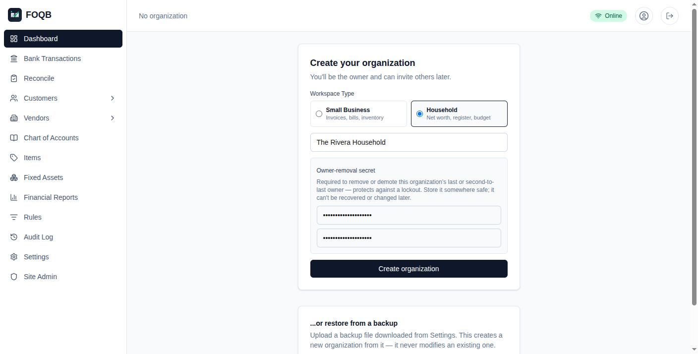
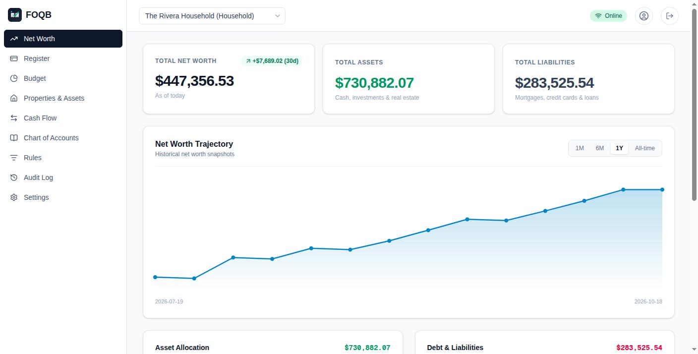
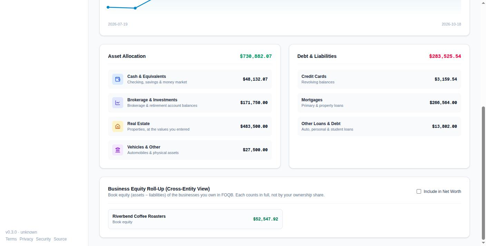
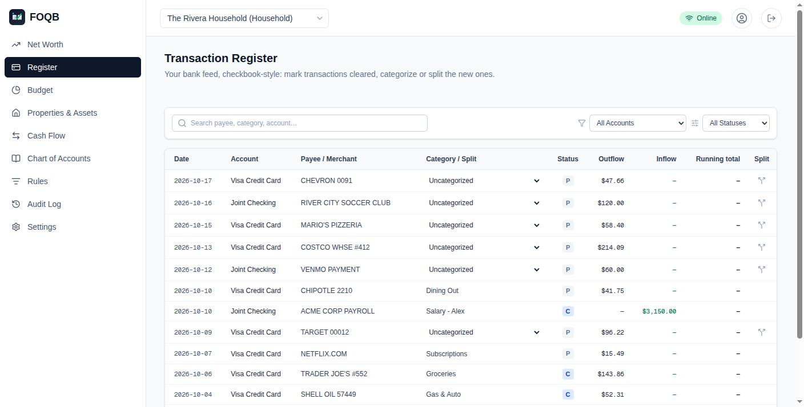
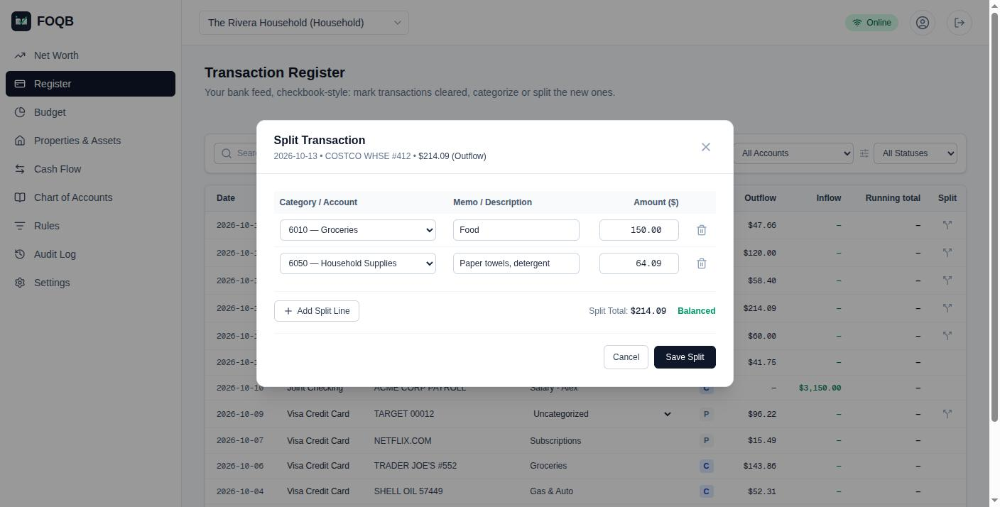
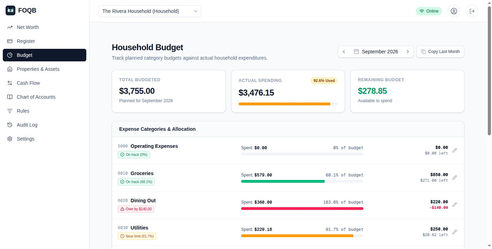
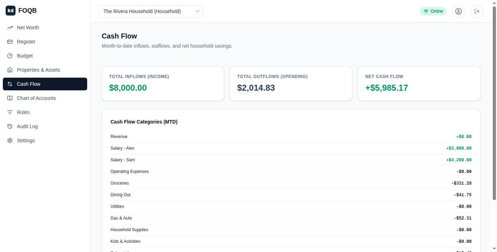
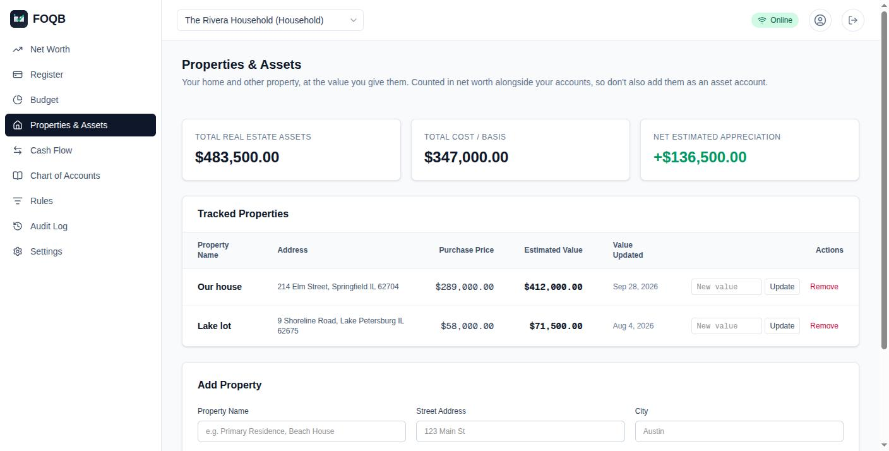

# Household workspaces

An organization can be a **household** instead of a business. It uses the
same double-entry ledger, bank connections, roles and row-level security as a
business; only the screens differ. You can belong to both kinds and switch
between them from the header.

Choose the kind when you create the organization ("Small Business" or
"Household"). It's stored in `organizations.workspace_type`.

To try it with sample data, create a household and run
`scripts/seed-sample-household.sql` on it (instructions at the top of the
file): three months of a family's paychecks, bills and card spending, a bank
feed, two properties, budgets and net worth history. The screenshots here
come from it.

| | Business | Household |
|---|---|---|
| Home page | Business dashboard | Net worth |
| Menu | Transactions, reconcile, customers, vendors, items, fixed assets, reports… | Register, bank transactions, reconcile, budget, properties & assets, cash flow, chart of accounts, journal entries, rules, audit log, and any enabled plugin's pages |

The business pages still work in a household if you go to them directly; the
menu just leaves them out.

## Net worth (`/`)

- **Account balances** come from `get_balance_sheet`, the same database
  function the balance sheet report uses, so every posted entry counts.
- **Buckets** are picked from the account's name, since the chart of accounts
  only knows asset and liability: cash (cash, checking, savings, money
  market, or a number starting `10`), investments (brokerage, IRA, 401k, 403b, 457b, HSA,
  stock…), real estate (home, house, property…), and everything else under
  "Vehicles & Other". Debts split into mortgages, credit cards, loans and
  other. An account with a bank feed (linked through Plaid, or with
  imported transactions) whose name doesn't say counts as cash, or as a
  credit card if it's owed (`has_bank_feed` in
  `supabase/migrations/20260101000062_has_bank_feed.sql`).
- **Every figure opens what's in it**: each tile, section heading and row
  lists the accounts and properties behind it, each linked to its ledger
  or to Properties.
- **Properties** (below) are added at their estimated value.
- **Business equity**: if you own business organizations in FOQB, their book
  equity (assets − liabilities) is listed, and you can tick "Include in Net
  Worth". Each business counts in full, not by your ownership share.
- **History**: the chart and the 30-day change are worked out from the
  books (`get_net_worth_series`): a point for every day of the last six
  months (1M, 6M) and for each month-end back to the first entry (1Y,
  All-time). Properties count at today's estimated value from their
  purchase date on, and an investment account moves only where a statement
  is booked, so daily points step at statement ends. Household figures
  only, without business equity.

## Register (`/register`)

A checkbook-style list of the bank feed's transactions, newest first: the
latest 1,000 with "Load older" for more, or one account's whole history
when you pick an account. It draws 200 rows at a time, with "Show more"
for the rest; search, filters and running balances cover every row loaded.

- **Status**: click to mark a transaction cleared (`C`) or not (`P`). `R`
  means a bank reconciliation covers it; that's set by reconciling, not here.
- **Category**: an uncategorized transaction can be booked to an account from
  the dropdown, or split across several (below). "+ New account…" at the end
  of the list creates one on the spot. After categorizing, the register
  offers a payee rule ("contains …") that also books the matching
  uncategorized rows.
- **Changing it**: a categorized transaction's category stays a dropdown,
  even once reconciled; the bank side and its reconciliation are kept.
  "Re-open" sends it back to be categorized or split again, unless it's
  reconciled or otherwise locked. The eye button ignores an uncategorized
  transaction, a duplicate say: it shows "Ignored", stays out of the
  running balance, and "Re-open" brings it back. See
  [BANK_FEED.md](BANK_FEED.md#categorizing).
- **Transfers**: money moving between two of your linked accounts, such as
  paying the card from checking, offers "Transfer to …", booking both sides
  as one entry. "Book all N matched transfers" books every pair waiting. See
  [BANK_FEED.md](BANK_FEED.md).
- **Running total**: once you pick a single account, the running total of the
  transactions listed. It starts from the first one shown, so it matches your
  bank balance only if the list goes back to the account's start.

## Split transactions

One bank charge booked to several accounts, such as a store run that was part
groceries and part household supplies. Every line needs an account and an
amount above zero, and the lines must add up to the transaction exactly. It
posts one balanced journal entry through `post_journal_entry`.

## Budget (`/budget`)

A planned amount per expense account per month (`monthly_budgets`), against
what was spent: debits less credits to that account in posted entries that
month, from `get_income_statement`. Over 80% shows a warning, over 100% shows
over budget. "Copy Last Month" carries last month's amounts forward. Each
category opens its ledger for the month. The start-up assistant plugin can
start a budget from your average spending ([PLUGINS.md](PLUGINS.md#start-up-assistant)).

## Cash flow (`/cash-flow`)

This month so far: income and spending by account, and the difference (what
the household saved). Like the budget, it counts posted entries, so a
transaction still uncategorized in the register isn't in it yet. Each
category opens its ledger for the period.

## Properties (`/properties`)

Your home and other property, at the value you give them. Update a value
whenever you have a new estimate (an appraisal, a tax assessment, a listing
site). Properties sit outside the ledger: they're added to net worth directly
and no journal entries are made, so don't also record the same property as an
asset account.

With the mortgage notes plugin, mortgages you hold as the lender are
listed here too ([PLUGINS.md](PLUGINS.md#mortgage-notes)).

There's no automatic valuation. Doing that well needs a paid property-data
service; scraping Zillow and similar sites is against their terms.

## Chart of accounts and journal entries

Each account in the Chart of Accounts (`/accounts`) opens its ledger:
every entry, with a running balance. Journal Entries (`/journal`) lists
every entry, newest first, 50 a page, with a memo search; one can be
voided there, except an entry from the bank feed, which is re-opened in
the register instead.

## Tax lines

Settings → Tax form "Form 1040 with Schedules 1, B, C, D and E
(individual)" lets each account in the Chart of Accounts be tagged with a
line from those forms, the way a business book tags Schedule C lines. An
account on a Schedule E line also picks which of the book's properties it
belongs to, so each rental gets its own column. The Tax Line report
(`/reports?report=tax-line-items`; the household menu has no Reports entry) totals
each line, per property for Schedule E, and opens the accounts behind it.

## Investments: not included

Brokerage and retirement accounts count toward net worth through their ledger
balances, like any other account. FOQB doesn't import holdings (shares,
prices, cost basis). Doing that through Plaid needs its **Investments**
product, which is separate from the Transactions product the bank feed uses:
your Plaid account has to be approved for it, and Plaid charges for it
separately. If you want to add it, the pieces are Plaid's
`/investments/holdings/get`, a holdings table with the same row-level
security as the others, and requesting `investments` in the link token.

## Backups

The organization backup (Settings) includes properties, budgets, the net
worth history, the register's cleared marks, accounts' properties and the
plugins' data, and restoring puts them all back.
