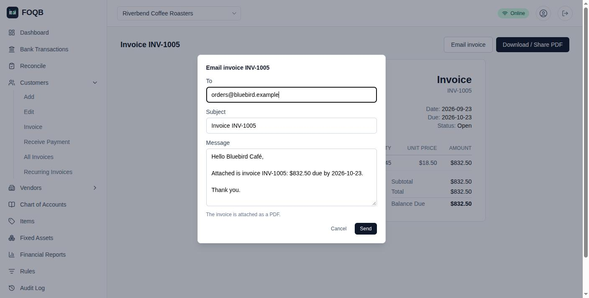
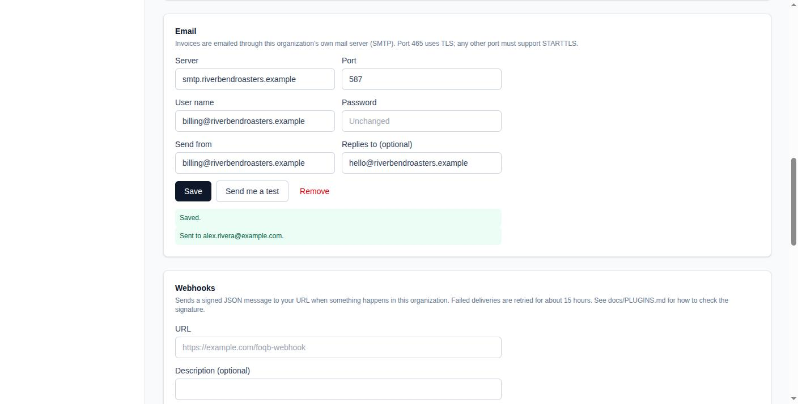
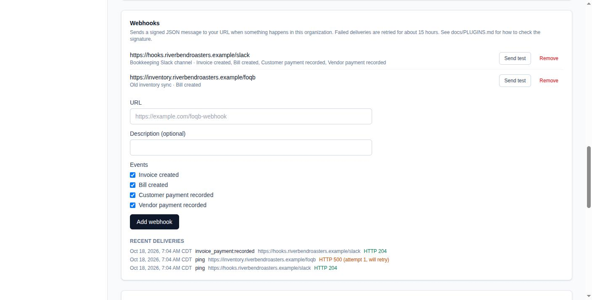
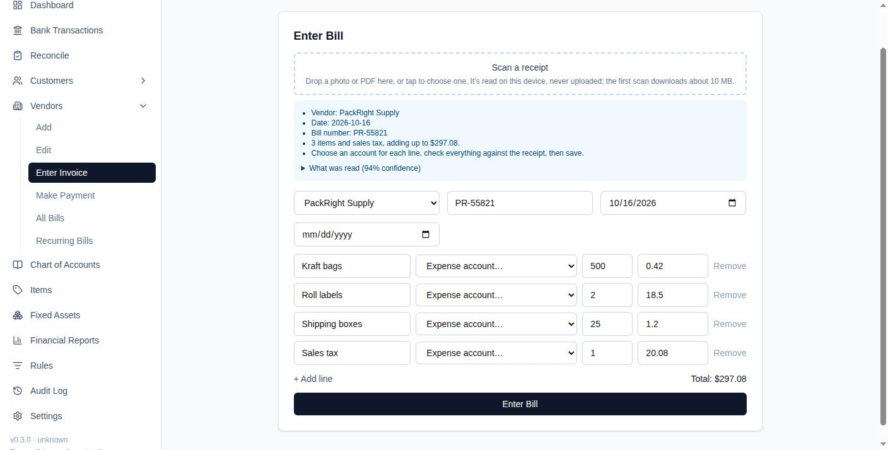

# Plugins

FOQB has a small, in-repo plugin system: **events** a plugin can react to on
the server, **slots** where a plugin can put its own controls in the UI, and
**pages** of its own in the menu.
Six plugins ship with FOQB, each off until you turn it on:
[email invoices](#email-invoices), [webhooks](#webhooks),
[receipt scanning](#receipt-scanning),
[statement import](#statement-import),
[mortgage notes](#mortgage-notes) and the
[start-up assistant](#start-up-assistant).

Plugins live in this repository (`plugins/<id>/`), or in a private repo of
your own (see [Private plugins](#private-plugins)), and are compiled in
with the app. There's no runtime loading of third-party code, on purpose: a
plugin runs with the signed-in user's access to their books.

## Turning plugins on

A plugin runs only if the operator turns it on, with `FOQB_PLUGINS` in the
app's environment:

| `FOQB_PLUGINS` | Runs |
|---|---|
| unset or `*` | plugins whose manifest says `enabledByDefault: true` (none, so far) |
| `none` | nothing |
| `email-invoices,webhooks,receipt-ocr,statement-import,mortgage-notes,startup-assistant` | exactly those |

Each plugin the instance runs is on in every book until the book's owner
turns it off under Settings → Plugins. That hides its slots, pages and
menu links in that book; its server-side events, jobs and statement
readers still run instance-wide. A plugin may also list `settings` (text,
select, multiselect, boolean or number) for owners to set per book, read
with `getPluginSettings`. Every member of the book can read them, so they
hold choices, never secrets.

## Writing one

```ts
// plugins/hello/index.ts
import type { FOQBPlugin } from "@/lib/plugins/types";
import { HelloButton } from "./hello-button";

export const helloPlugin: FOQBPlugin = {
  manifest: { id: "hello", name: "Hello", version: "0.1.0", description: "Says hello." },
  hooks: {
    "invoice:created": async ({ invoiceNumber, orgId }) => {
      console.log(`Invoice ${invoiceNumber} created in ${orgId}`);
    },
  },
  slots: { "invoice.actions": HelloButton },
};
```

Add it to `builtInPlugins` in `plugins/index.ts` (a private one registers
itself, below), and to `FOQB_PLUGINS`.

A plugin's `index.ts` is imported by both the server and the browser (for
its slots), so it must not import anything server-only (secrets, the
service-role client, outgoing requests). Two places for that:

- **Actions** the plugin's components call: a `"use server"` file. Anyone
  signed in can call a server action, so each one checks who's asking.
- **Event handlers, background jobs and categorizers** that use secrets
  or the network: `ServerPluginParts`, listed by plugin id in
  `plugins/server.ts`, which only the server loads. A categorizer gets the
  first look at each new bank transaction (from the feed or a statement
  import), before the book's rules, and returns true if it booked it. A job (`{ name, minIntervalSeconds, run }`) runs off
  real traffic like FOQB's own maintenance (see
  [SELF_HOSTING.md](SELF_HOSTING.md)): at most once per interval, and only
  while someone is using the app.

### Private plugins

A plugin that shouldn't be public (your own tax worksheets, say) lives in a
repo of your own, checked out as `plugins/local/`, which this repo ignores.
Each folder there is a plugin: its `index.ts` (or `.tsx`) exports `plugin`,
and an optional `server.ts` exports `server` (its `ServerPluginParts`).
`scripts/local-plugins.mjs` registers them after `npm install` and before
every build and dev server; `FOQB_PLUGINS` turns them on like any other.
A private plugin can't reuse a shipped plugin's id.

```
plugins/local/            # git clone <your repo> plugins/local
  tax-forms/
    index.ts              # export const plugin: FOQBPlugin = { ... }
    server.ts             # export const server: ServerPluginParts = { ... }
```

- **Same trust as FOQB's own code.** It's built into your instance, by
  you; nothing is loaded at runtime. Review it as you would a change to
  FOQB itself.
- **No migrations.** A private plugin keeps its values in `plugin_data`
  (`getPluginData` / `setPluginData` in `lib/plugins/data.ts`): JSON under
  keys of its own, per book, that the book's members can read and only its
  writers can change. They're in the book's backup.
- **Deploying.** The CI deploy job clones `paul/foqb-private` into
  `plugins/local` when the `FOQB_PRIVATE_DEPLOY_KEY` secret holds the
  private half of a read-only deploy key on that repo (a key that reads
  that one repo, unlike a user's access token); `vercel deploy` uploads the
  folder (it doesn't follow `.gitignore`). On another host, clone your repo
  there before building.
- **License.** FOQB is AGPL: if people other than you use an instance
  running a private plugin, they're entitled to its source.

### Events

Emitted on the server after the change is saved, by every path that makes
it (the recurring invoice and bill generators included). All handlers run
together; one that throws, or takes longer than 5 seconds, is logged and
skipped, and never fails the request. Queue anything slow.

| Event | When | Payload |
|---|---|---|
| `invoice:created` | an invoice is posted | `invoiceId`, `invoiceNumber`, `customerId`, `total`, `orgId` |
| `bill:created` | a bill is posted | `billId`, `billNumber`, `vendorId`, `total`, `orgId` |
| `invoice_payment:recorded` | a payment (possibly partial) is applied | `paymentId`, `invoiceId`, `invoiceStatus`, `orgId` |
| `bill_payment:recorded` | a payment (possibly partial) is applied | `paymentId`, `billId`, `billStatus`, `orgId` |

There's deliberately no "journal entry posted" event yet: entries are posted
from several places (forms, bank categorization, splits, the Plaid sync),
and an event that missed some of them would be worse than none. Doing it
properly means a database trigger feeding a queue.

### Slots

| Slot | Where | Context |
|---|---|---|
| `invoice.actions` | beside "Download / Share PDF" on an invoice | `invoiceId`, `invoiceNumber`, `customer` (`name`, `email`), `total`, `remaining`, `dueDate`, `status`, `buildPdf()` (the same PDF the button makes) |
| `settings.sections` | a section of its own on the Settings page | `organizationId` |
| `dashboard.sections` | below the dashboard's own figures, household or business | `organizationId`, `workspaceType`, `canWrite` |
| `properties.sections` | a section of its own on Properties & Assets | `organizationId`, `canWrite` |
| `reconcile.header` | at the top of the Reconcile page, for writers | `accounts` (`id`, `name`, `account_number`, `type`) |
| `bill.header` | above the Enter Bill form | `vendors`, `accounts`, `prefill(bill)`: fills in any of `vendorId`, `billNumber`, `billDate`, `lines` |

A slot with no plugin in it renders nothing.

### Pages

A plugin can have pages of its own: each entry in `pages` (`slug`,
`title`, optional `description`, optional `workspace: "business" |
"household"`, and `component`) is served at `/plugins/<plugin id>/<slug>`
and listed in the menu, before Settings, while the plugin is enabled and
the book is the right kind. The component renders in the browser and gets
`context`: `organizationId`, `workspaceType`, `canWrite`, and `books` (every
book the signed-in user belongs to: `id`, `name`, `workspaceType`,
`currency`), for a page that reads across books. Every read goes through
that book's own access rules, and each book's amounts are in its own
currency (see [CURRENCY.md](CURRENCY.md)); a page that adds books together
converts them itself.

## Email invoices

`FOQB_PLUGINS=email-invoices`. Adds an **Email invoice** button to each
invoice, which sends the customer the invoice PDF, and an **Email** section
to Settings.





- **Each organization uses its own mail server.** An owner enters its SMTP
  server, port, user name, password, the address mail is sent from, and an
  optional reply-to address, then can send themselves a test. Mail goes out
  as "Organization Name <send-from address>". The password is encrypted with
  `ENCRYPTION_KEY` and no signed-in user can read it back, owners included.
- **Always encrypted.** Port 465 uses TLS from the start; any other port
  (usually 587) must offer STARTTLS, or nothing is sent.
- **Who can send:** owners and accountants. The server looks the invoice up
  with the sender's own access; the browser supplies only the recipient
  (prefilled with the customer's email), subject, message and the PDF it
  rendered. Void invoices can't be sent.
- **Limits:** 50 emails per organization per hour, and 5 test messages.
- **Record:** each email sent is recorded with who sent it, to whom and when;
  it shows in the Audit Log and as "Last sent" in the email dialog. Neither
  the mail server settings nor this record are in the organization backup.
- **Private networks:** the app refuses mail servers on private or local
  addresses, so owners can't use it to reach internal services. On a
  self-hosted instance whose users you trust, with a mail server on your
  LAN, set `ALLOW_PRIVATE_NETWORK_HOSTS=true`.

## Webhooks

`FOQB_PLUGINS=webhooks`. Adds a **Webhooks** section to Settings, for
owners: each webhook is an `https` URL and the events it wants (any of the
four [events](#events)). On each event, FOQB POSTs:

```json
{
  "id": "delivery id",
  "event": "invoice:created",
  "created_at": "2026-10-17T21:14:03.120Z",
  "organization_id": "…",
  "data": { "invoiceId": "…", "invoiceNumber": "INV-1001", "customerId": "…", "total": 558 }
}
```

with headers `X-FOQB-Event`, `X-FOQB-Delivery` (the same id, for spotting
repeats), `X-FOQB-Timestamp` (Unix seconds) and `X-FOQB-Signature`.
"Send test" posts a `ping` event.

**Checking the signature.** Each webhook has its own secret, shown once when
it's added. The signature is an HMAC-SHA256, keyed with the secret, of the
timestamp, a dot, and the raw body:

```js
import { createHmac, timingSafeEqual } from "node:crypto";

function isFromFoqb(rawBody, headers, secret) {
  const timestamp = headers["x-foqb-timestamp"];
  const expected = "sha256=" + createHmac("sha256", secret).update(`${timestamp}.${rawBody}`).digest("hex");
  const given = headers["x-foqb-signature"] ?? "";
  const fresh = Math.abs(Date.now() / 1000 - Number(timestamp)) < 300; // refuse replays
  return fresh && given.length === expected.length && timingSafeEqual(Buffer.from(given), Buffer.from(expected));
}
```

**Delivery.** Messages are queued, and sent once the request that caused
the event has finished, so a slow receiver never slows anyone down. A
receiver has 10 seconds to answer with a 2xx; redirects aren't followed.
Anything else is retried after 1, 5, 30, 120 and 720 minutes, then marked
failed. Retries run while the app is in use, so on a quiet instance they can
be late. Settings shows the last 20 deliveries; records are kept 30 days.



**Safety.** URLs must be `https` and reach a public address, checked when
the webhook is added and again on every delivery
(`ALLOW_PRIVATE_NETWORK_HOSTS=true` lifts this, as for email). An
organization can have up to 10 webhooks. Secrets are encrypted with
`ENCRYPTION_KEY`, and no signed-in user can read them back.

## Receipt scanning

`FOQB_PLUGINS=receipt-ocr`. Adds a drop zone above the Enter Bill form:
drop a photo or PDF of a receipt (or, on a phone, take one), and the form
fills in what could be read. Nothing is entered until the person clicks Enter Bill.



- **Read on the device.** A PDF with text is read directly
  ([pdf.js](https://mozilla.github.io/pdf.js/)); a photo or a scanned PDF
  goes through [Tesseract](https://tesseract.projectnaptha.com) in the
  browser. The receipt is never uploaded. The OCR engine and its English
  model (about 10 MB, downloaded on the first scan and then cached) are
  served by the app from `/ocr`; `npm run build` and `npm run dev` copy them
  there from `node_modules` (`scripts/copy-ocr-assets.mjs`), so no CDN is
  involved.
- **Fills in only what it found:** the vendor, when exactly one of the
  organization's vendors is named at the top of the receipt (otherwise it
  shows the name it saw and the person picks); the date; the receipt number
  as the bill number; and the lines. Line items are copied only when they,
  plus tax, add up to the total; otherwise there's one line for the total.
  Accounts are always left for the person to choose.
- **Shows its work:** a list of what was filled in and what wasn't, the text
  it read, and Tesseract's confidence, with a warning below 70%.
- **Limits:** English, US-style amounts and dates (`12.34`, `10/14/2026`),
  and the first page of a PDF. The parser (`plugins/receipt-ocr/parse.ts`)
  is a plain function with tests, the place to add other formats.

## Statement import

`FOQB_PLUGINS=statement-import`. Adds "Import a Statement" to the Reconcile
page: choose a bank or card statement PDF, check what was read, pick the
account (one named with the statement's last four digits is picked for
you; when there's none, a new account named for the statement is offered,
and created on import), and import. An account, linked or not, opens at its earliest imported
statement's opening balance.

- **Read on the device**, with [pdf.js](https://mozilla.github.io/pdf.js/),
  like receipt scanning; the PDF isn't uploaded, only the transactions read
  from it are sent to import. Scans are read with OCR (below).
- **Checked before anything is booked:** the opening balance plus the
  transactions read must come to the statement's closing balance, to the
  cent, in the browser and again on the server. A statement that doesn't
  add up is refused. When no reader knows a layout, or what was read
  doesn't add up, "Inspect document structure" shows the lines read with
  the dates, amounts, balances and account number found in them, to help
  write a reader for it (below). Nothing is imported from there.
- **No duplicates:** a statement transaction that's already in the
  register (the same amount, dated up to 3 days apart, as the bank feed
  sometimes dates things differently) is skipped, and importing the same
  statement twice adds nothing the second time. A statement for an
  account already reconciled through its end is refused: its money is in
  the books, even if a reader now reads it into different rows.
- **Booked like the bank feed:** new transactions go through the
  categorization rules and transfer matching, and the account's opening
  balance moves earlier if the statement goes back further than the feed.
- **Reconciled when the books allow:** the import starts a reconciliation
  for the statement's date and closing balance, and completes it when
  everything on the account up to that date adds up to it. Until then it
  stays in progress: categorize the rest in the register, then import the
  statement again (or finish it on the reconciliation page). One waiting
  only on transfers is finished when the other account's statement brings
  their other side.
- **Settling earlier history** (a checkbox, off unless ticked): for an
  account whose feed goes back before the statement, "Everything before
  this statement is settled" closes that history at the statement's
  opening balance. Transactions from before it that are still to
  categorize are ignored (restorable from the register); those already
  booked keep their entries, with one adjustment against equity for any
  difference; and it all clears in a reconciliation dated the day before
  the statement.
- **Layouts:** Capital One 360 (several accounts in one statement), and
  Bank of America checking, savings and credit cards. Any other bank gets
  a best guess (`parseGeneric`): rows that start with a date and carry an
  amount, between the balances its labels name ("Beginning balance", "New
  balance"), each amount signed as printed, by the section it's under or by
  a running balance, whichever adds up to the closing balance. A statement
  no guess balances is refused, never booked; several accounts in one PDF
  need a reader of their own (below).
- **Scans:** a page with no text (a scanned or image-only statement) is
  rendered and read with OCR on the device, using the Tesseract engine the
  app serves for receipts (`ocrLines` in `text-lines.ts`), then goes to the
  same readers. OCR slips usually show up as a statement that doesn't
  balance, which is refused. The readers
  (`plugins/statement-import/parse.ts`) are plain functions with tests.

### Adding a bank

When the best guess refuses your bank's statements, or reads them wrong,
give it a reader of its own. A reader is a plain function from the
statement's text lines to `ParsedStatement`s, and it goes in a plugin of
your own (a [private one](#private-plugins) if you'd rather not publish
which banks you use) as `statementReaders`:

```ts
import { cells, dateInPeriod, parseMoney, type ParsedStatement, type StatementReader } from "@/plugins/statement-import/parse";

function parseMyBank(lines: string[]): ParsedStatement[] {
  // Find the period, account number and opening and closing balances in
  // lines.join("\n"), then a row per transaction: date, description, and
  // amount (negative for money out, or a charge on a card).
}

export const plugin: FOQBPlugin = {
  manifest: { id: "my-bank-statements", name: "My bank's statements", version: "0.1.0", description: "…" },
  statementReaders: [{ detect: /mybank\.com|My Bank/i, read: parseMyBank }],
};
```

Turn it on alongside `statement-import` in `FOQB_PLUGINS`. When more than
one reader's `detect` matches, the one whose bank is named first in the
statement wins, since another bank's name can turn up later in a
transfer's description. Some tips:

- **See what the reader gets.** Each line is one printed line, its columns
  joined with `" | "` (`pageLines` in `text-lines.ts`); a scan's lines
  come from OCR the same way. Write the reader against a few real
  statements' lines, then put made-up lines of the same shape in its
  tests.
- **Use the helpers**: `parseMoney` (`1,234.56`, `-$5.00`, `.06`),
  `cells`, `monthIndex`, `isoDate`, and `dateInPeriod` for a day printed
  without its year, which puts December in the year before a January
  statement.
- **Let the balance check catch mistakes.** A reader doesn't have to be
  sure: anything that doesn't come to the closing balance to the cent is
  refused before it's booked.
- **Or fall back on the guess.** A reader can call `parseGeneric(lines,
  "My Bank")` for one of the bank's layouts that the guess already reads,
  just to name the bank.

## Mortgage notes

`FOQB_PLUGINS=mortgage-notes`. For mortgages the book holds, the borrower
paying you. Adds "Mortgage Notes You Hold" to Properties & Assets, for
owners and accountants.

- **Each note** has the borrower's and lender's names, addresses and
  taxpayer ids (encrypted with `ENCRYPTION_KEY`, shown only as the last
  four digits, and left out of the organization backup), the property
  securing it, and its fixed terms: principal, rate, term, first payment
  date, the monthly principal and interest (worked out from the terms if
  left blank) and any monthly escrow. Adding one makes its accounts: the
  note receivable, its interest income, and escrow held. What was owed when
  the books take it up is booked as the note's opening balance (by the
  schedule, unless you enter it).
- **Payments book themselves.** A deposit whose description contains the
  text you give (the borrower's name as their bank's Zelle shows it) is
  split into the month's interest on the balance owed, then the escrow
  due, then principal; extra goes to principal. Anything else, a renter's
  Zelle for one, goes to the rules as usual. A payment dated on or before
  the note's opening balance is in that balance already, so it's left to
  the rules too: to start a note at January 1, open it on December 31 at
  what was owed after December's payment. Payments already waiting when
  the note is added are booked then, oldest first; "Book waiting
  payments" does it again (after re-opening one categorized by hand).
  "Edit" changes the terms or the opening balance and splits the booked
  payments again on them; a reconciled payment keeps the split it has.
- **Form 1098** for any year: box 1 (interest received), box 2 (principal
  owed on January 1), box 3 (origination date) and box 8 (property), plus
  principal and escrow received and paid out. Box 1 is also the borrower's
  line on your Schedule B. "Borrower's statement to print" makes their
  copy; the IRS copy is filed on the official form or electronically.
- **Limits:** fixed-rate, monthly, fully amortizing notes; one month's
  interest per payment, so a missed month isn't charged twice; no late
  fees.

## Start-up assistant

`FOQB_PLUGINS=startup-assistant`. For starting a book from statements and
bank feeds that reach back different distances. Each account's opening
balance already holds everything dated on or before it, so history from
before it, like another bank's old transfer to it, belongs to equity.

- **The guard.** Until the book is done, nothing can be booked to an
  account on or before its opening balance's date; the error says to book
  it to equity. It's on for a book once someone who can edit it opens
  Reconcile.
- **Clean up** (on Reconcile) moves what's already there: each such entry
  is re-booked with that line on equity, the other side (and its
  reconciliation) as it was; that account's own old feed row is set aside,
  as are its other feed rows from before it. A line already reconciled on
  that account stays: a settled history adjusted for it.
- **All done** turns the guard off for the book and hides the assistant.
  A household book is first asked whether to start a budget from its
  average spending: each expense account's spending over the whole months
  the books now cover (from the month after the earliest opening balance
  to the last finished month, both changeable; at most 36), divided by the
  number of months and rounded to whole dollars, is budgeted in each of
  those months. A month already budgeted for an account keeps its amount.
  To carry it into the current month, open that month on the Budget page
  and click Copy Last Month. A household's net worth chart starts over
  that day: the points saved while accounts were being entered are cleared.
