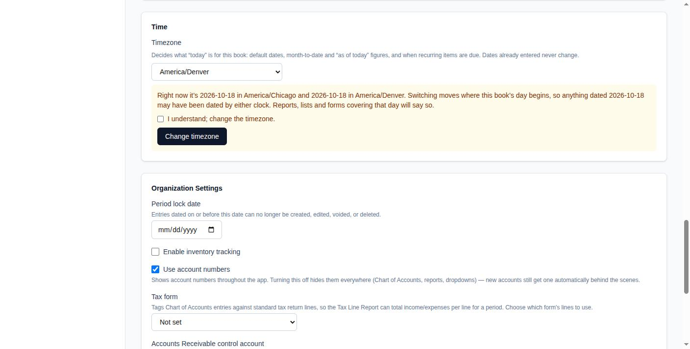
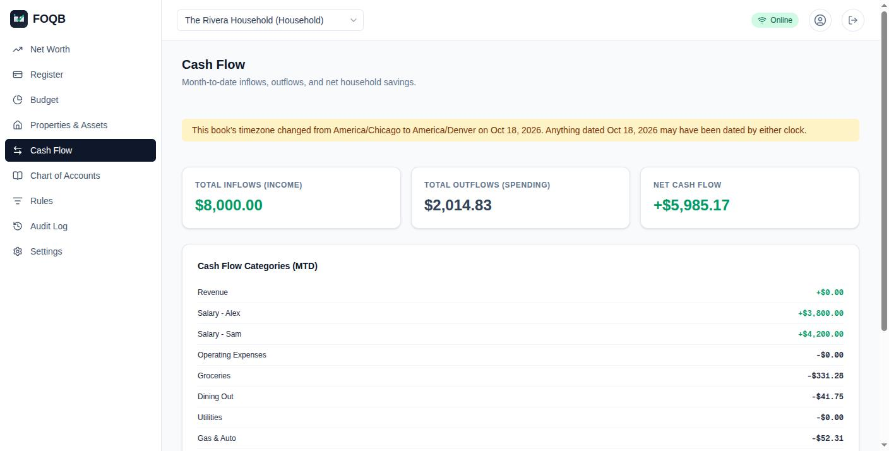

# Book timezones

Each organization ("book") has its own timezone, which decides what day it
is for that book. Run a business in Denver and a household in Chicago and
each one's "today" is its own.

The timezone decides:

- the date new entries, invoices and bills start with;
- month-to-date and "as of today" figures on dashboards, reports, the
  budget and cash flow;
- when recurring invoices and bills are due;
- how times are shown, such as in the audit log ("Oct 17, 2026, 9:14 PM
  CDT").

Dates already entered never move. A journal entry dated October 17 stays
October 17 whatever the timezone. Bank transactions keep the date the bank
reported.

## Setting it

New organizations start in the timezone of the browser that created them.
Organizations from before timezones existed follow the instance's
`DEFAULT_TIMEZONE` (UTC if unset; see [SELF_HOSTING.md](SELF_HOSTING.md))
until an owner picks one under **Settings → Time**.

Changing `DEFAULT_TIMEZONE` later moves every organization still following
it, and that isn't recorded as a change (so no notice appears). Give those
organizations their own timezone first if that matters.

## Changing it

Changing the timezone moves where the book's day begins, so for the day or
two around the change, something dated "today" may have been dated by
either clock. FOQB records each change, and every report, list and form
covering an affected day says so at the top:

Only owners can change it. The changes are kept in
`organization_timezone_changes` and included in the organization backup.
